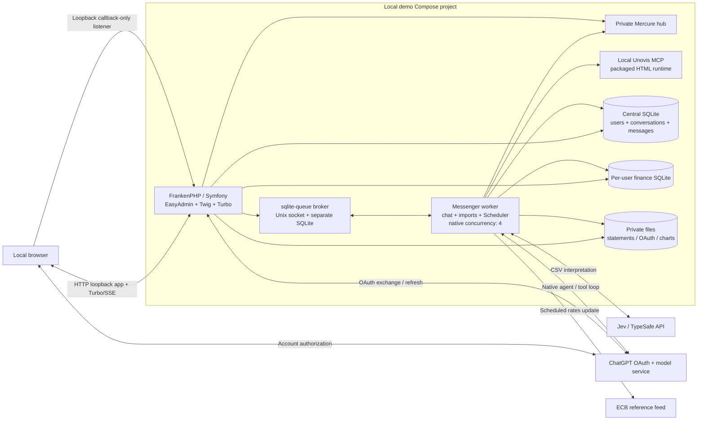
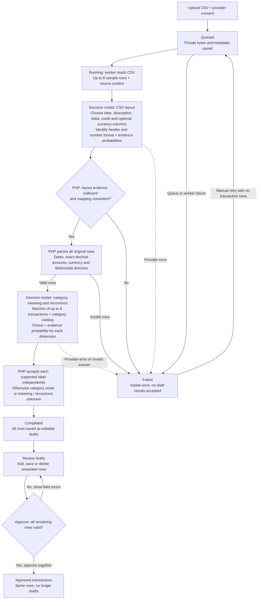
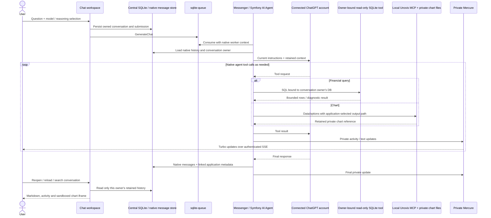
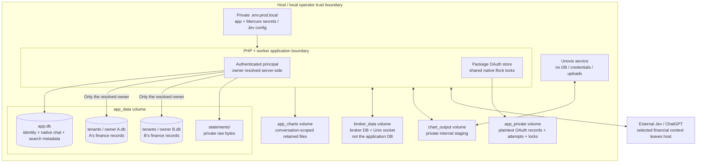

# Architecture

Personal finance is a local Symfony application, not a separate chat frontend plus financial API. EasyAdmin owns the authenticated workspace; Twig, AssetMapper, Stimulus and Turbo provide the UI. Symfony AI owns the agent/tool loop and native message storage. SQLite stores identities and conversations centrally, with a separate authoritative finance database for each ordinary user.

This document describes the current implementation. Accepted [ADRs](docs/adr/README.md) explain decisions; [SPEC.md](SPEC.md) also includes future requirements. [README.md](README.md) covers installation.

## Runtime overview

Only the application listener and callback-only listener publish loopback host ports. SSE reaches Mercure through Caddy's application route; the broker, MCP service and hub have no published host ports. No public financial/database API or raw file directory is exposed. The Unovis service sees only chart staging—not tenant databases, uploads or OAuth records.

Production PHP, broker and worker use the same compiled `--no-dev` image as UID/GID 1000. The one-off `frankenphp_demo_setup` image includes development dependencies solely to invoke the existing dev-mode canonical Alice loader. It is not a production service. `make` delegates to an internal Bash helper to apply Doctrine migrations, append canonical fixtures only to fresh storage and record successful completion. A normal rerun migrates without reseeding; ambiguous/incomplete nonempty storage is refused. `make start`, `make stop` and `make restart` manage an existing demo without provisioning; none purges or removes volumes. Development and QA remain in Castor. See [ADR 0031](docs/adr/0031-local-demo-packaging.md).

## Statement workflow

The authenticated user selects an account/card and uploads a CSV of at most 10 MiB with explicit provider consent. Symfony stores the bytes privately, saves metadata in the owner's finance database and queues a Messenger import job.

Both decision stages use Symfony AI's Decision platform bridge. Jev chooses from supplied options and answers evidence questions; PHP validates those judgments and preserves the original financial facts. Missing or ambiguous layout evidence stops processing. Classification labels are accepted independently at evidence probability **at least 0.7**; uncertainty leaves the label unset/unknown rather than rejecting the row. Jev does not match transfer pairs or infer exchange rates. See [ADR 0021](docs/adr/0021-fixtures-first-jev-import.md).

**Completed means ready for review, not approved.** Approval validates all remaining drafts before clearing their draft flags together; the statement stays Completed, and unknown classifications may remain. Manual retry reuses the stored file and is available only for failed/running statements with no transaction rows.

Parsing/provider work is outside database write transactions. Finance records and statement downloads are owner-scoped; stored filenames are not public URLs. Private Mercure/Turbo updates bring completed results or errors into the review page.

Decision-model processing is independent of ChatGPT sign-in. PDF/XLSX conversion through local MarkItDown is an accepted future direction, **not a running service or implemented extraction path in this release**. OCR remains unresolved. The packaged walkthrough uses CSV and the existing synthetic fixture definitions.

## Chat, tools and retained history

ChatGPT credentials are per Finance account, handled through the installed OAuth package's file store; the application supplies the owner namespace and short-lived callback handoff. An ordinary user connects in Settings. Jev keys and OpenAI API keys do not replace that connection.

Symfony AI's native agent, message bag, tool dispatch and Doctrine message store remain authoritative. There is no parallel transcript, custom generation recovery engine, temporary/save history mode or per-user one-active-generation gate. New-chat drafts are unstored until submission; owned retained conversations support favourites and native SQLite FTS5 search. Model/reasoning selection is per turn, and target-model history conversion is request-only. Existing messages are not rewritten to accommodate a model switch.

The SQL tool opens only the resolved owner's finance file read-only, with a default-deny SQLite authorizer and bounded input/result sizes. It has no external database/host file capabilities or model-selected owner. **It does not have a hard execution deadline**; expensive queries can occupy/exhaust a worker. SQLite arithmetic and aggregates may be approximate. Decimal-string financial storage and the application's BCMath converter do not make arbitrary model-authored SQL exact. Draft visibility is intentional; exclusion from ordinary reports is prompt guidance.

Unovis renders locally using its pinned packaged runtime. The application overrides output path/type and retains the resulting document privately against conversation metadata. It serves charts only after owner/membership checks, inside an iframe with `sandbox="allow-scripts"` and restrictive response CSP, without same-origin privileges or external network access. Model-generated arbitrary JavaScript is not an application extension point. Chart arguments/tool results and financial context may already have been sent to ChatGPT; local rendering is not an offline/privacy guarantee.

## Storage and trust boundaries

Administrators manage central users; that role does not confer access to tenant finances. HTTP endpoints, EasyAdmin actions, handlers, tools, downloads and event subscriptions must resolve ownership, not just test roles. The central database locates tenants; the model cannot choose a tenant path. Worker calls use the persisted conversation/statement owner, not a browser-supplied identity.

Volumes are Compose-project scoped and shared at identical paths by the relevant nonroot processes. Private records are protected by OS permissions, not encryption at rest; another process with the same UID or access to Docker can read them. Keep the environment file and all related volumes together when retaining an installation. Caches and image-compiled assets are not placed in the data volume. There is no backup/restore tooling or automatic cleanup/recovery promise in this packaging slice.

Uploaded bytes, record text, Markdown and model/tool output are untrusted. Rendered prose is sanitized/escaped; chart execution is isolated from the parent application. Do not log or commit raw statements, model exchanges, OAuth payloads or credentials. Structured Monolog output does not sanitize sensitive data automatically.

## Verification boundaries

[TESTING.md](TESTING.md) defines the small Playwright-only suite. Intercepted browser scenarios verify request/UI behavior with isolated Alice fixtures and native rollback. They do not prove broker/worker/Mercure integration; that requires an isolated running stack and actual browser interaction. A successful image smoke, source inspection or Compose validation is not proof of provider access, a completed import/chat journey, failure recovery or security certification. Special-case verification requires explicit owner approval.
